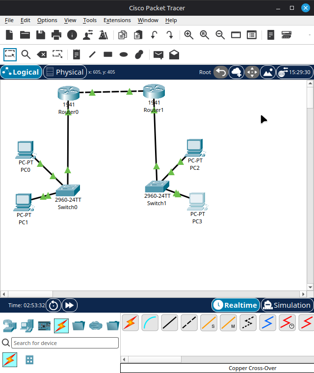
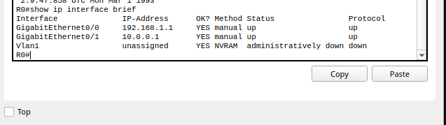
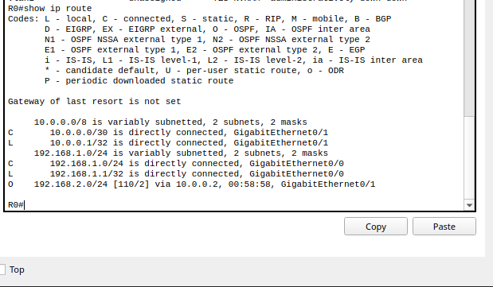
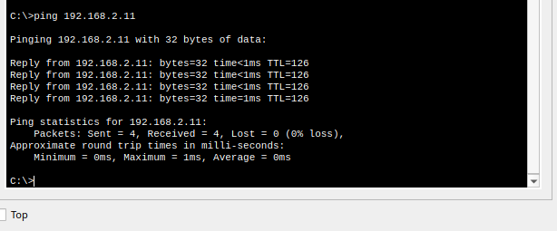
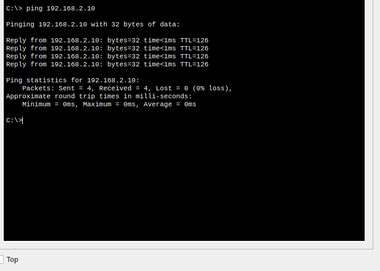

# Network Simulation Lab: OSPF Dynamic Routing

**Author:** Tadam James
**Environment:** Cisco Packet Tracer 9.0.1 (Host: Linux Mint 21.3)
**Objective:** Design, configure, and verify a multi-subnet network using OSPF dynamic routing to achieve full end-to-end connectivity.

## Topology Overview
- **2** Cisco 1941 Routers
- **2** Cisco 2960 Switches
- **4** End Devices (PCs)
- **Cabling:** Copper Straight-Through (End devices to Switches, Switches to Routers) and Copper Cross-Over (Router to Router).

## IP Addressing Scheme
| Subnet | Network Range | Mask | Devices |
| :--- | :--- | :--- | :--- |
| Left LAN | 192.168.1.0 | /24 (255.255.255.0) | PC0 (.10), PC1 (.11), Router0 Gi0/0 (.1) |
| WAN Link | 10.0.0.0 | /30 (255.255.255.252) | Router0 Gi0/1 (.1), Router1 Gi0/1 (.2) |
| Right LAN | 192.168.2.0 | /24 (255.255.255.0) | PC2 (.10), PC3 (.11), Router1 Gi0/0 (.1) |

## Configuration & Verification

### 1. Topology & Physical Layer

*All devices are connected and powered on. All interfaces have been configured with IP addresses and `no shutdown`, resulting in green link lights across the entire topology.*

### 2. Router Interfaces

*Router0 CLI showing both GigabitEthernet interfaces (`Gi0/0` and `Gi0/1`) with their assigned IP addresses and `up/up` status.*

### 3. OSPF Dynamic Routing

*Router0's routing table showing the right-side LAN (`192.168.2.0/24`) learned dynamically via OSPF (denoted by the `O` code), confirming the routing protocol is exchanging routes successfully.*

### 4. End-to-End Connectivity

*Ping tests conducted from PC0 to PC3, and PC1 to PC2, crossing two routers. Successful replies (0% loss, TTL=126) confirm the path is valid and exactly two routers were traversed (TTL starts at 128; 128 - 2 hops = 126).*

## Key Takeaways
- Successfully implemented a VLSM scheme using /24 for LANs and /30 for the point-to-point WAN link.
- Configured OSPF to avoid manual static routes, ensuring the network can adapt to changes automatically.
- Troubleshot initial interface lockups and CLI configuration issues using tools like `show ip interface brief` and `show ip ospf neighbor`.